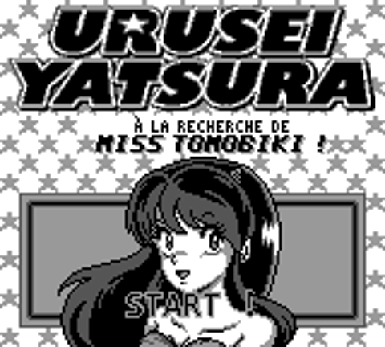
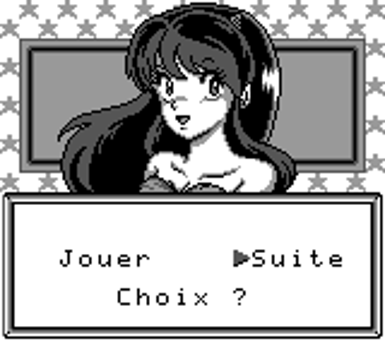
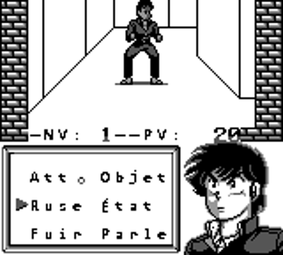

# Urusei Yatsura — Miss Tomobiki, traduction française

Traduction française du jeu Game Boy **Urusei Yatsura — Miss Tomobiki o Sagase!**, avec un éditeur local permettant d'extraire les textes, de modifier les traductions et de reconstruire une ROM.

La version actuelle est la **v1.6** : 436 chaînes traduites, police française dessinée sur une grille de 8 × 8 pixels, noms courts adaptés aux menus, logo latin sur fond étoilé et sous-titre stylisé. Cette version corrige le curseur de « Suite » et la bordure gauche du menu de combat.



## Utiliser le patch

Appliquer [le patch IPS v1.6](patches/Miss_Tomobiki_FR_v1.6.ips) à la **ROM japonaise originale de 256 Ko**, à l'aide d'un outil compatible IPS. La ROM obtenue mesure 512 Ko. Ne pas appliquer le patch à une ROM déjà traduite.

SHA-256 de la ROM japonaise prise en charge :

```text
65429bd2a36a33cd8ab696be2f485b647260b327039887931cec4775c718424f
```

SHA-256 de la ROM française v1.6 reconstruite :

```text
b9d28869db3e74c802829364d470ee6a816b66595128e011f325ec9c5358cb86
```

Le dépôt contient les patchs et les sources ; les ROMs et les sauvegardes d'émulateur restent locales.

## Lancer l'éditeur

Sur Windows, installer **Python 3.10 ou ultérieur**, avec Tkinter, et Pillow :

```powershell
py -3 -m pip install -r requirements.txt
```

Double-cliquer sur `editeur/Lancer.cmd`, puis charger la ROM japonaise originale. L'éditeur démarre avec la traduction française actuelle.

- Recherche dans les textes japonais et français, ou par adresse.
- Modification des dialogues et des noms complets, ainsi que de leurs variantes de 9 et 7 caractères.
- Aperçu des pages et des glyphes relus dans la ROM reconstruite.
- Grille et refus des débordements connus, caractères non disponibles et modifications des positions réservées.
- Sauvegarde du projet JSON, export des textes, import des traductions TXT.
- Création d'une nouvelle ROM et de son patch IPS.

L'aperçu représente le texte et son cadre. Les portraits et les valeurs dynamiques ne sont pas simulés ; vérifier en jeu les interfaces modifiées. Voir [le mode d'emploi](editeur/LISEZMOI.txt).

## Reconstruire depuis les sources

Les scripts de compilation utilisent également les polices Windows Consolas et Arial pour certains éléments graphiques. La police des dialogues, le logo et le sous-titre principal sont fournis dans les sources.

1. Copier sa ROM japonaise dans `editeur/sources/original.gb`.
2. Exécuter depuis la racine du dépôt :

```powershell
py -3 -X utf8 editeur/sources/extract.py
py -3 -X utf8 editeur/sources/build.py
```

La ROM française est créée dans `editeur/sources/fr_alpha.gb`. Les tables et manifestes de reconstruction sont produits dans `editeur/outputs/`. Ces fichiers sont ignorés par Git.

Les traductions sont dans `editeur/sources/translations.txt`, au format `ID=texte`. Les alias de menus sont dans `ui_names.json`. La police est dans `pixel_font.py`, les éléments graphiques dans `localize_graphics.py` et le logo dans `title_logo.py` avec ses ressources PNG.

Le texte intégré aux images, notamment le sous-titre de l'écran titre, se modifie dans les scripts graphiques. L'éditeur de chaînes concerne les 436 textes extraits.

## Vérifications

```powershell
py -3 -X utf8 tests/test_roundtrip.py --rom chemin/vers/lamujp.gb
```

Ce contrôle extrait les 436 chaînes, reconstruit la version actuelle, vérifie son empreinte, modifie un dialogue et ses alias de noms, puis applique le patch généré pour contrôler la reconstruction octet par octet. Il vérifie aussi la migration des anciens projets et le refus de plusieurs modifications invalides.

Les régressions des menus peuvent également être vérifiées dans PyBoy :

```powershell
py -3 -m pip install -r requirements-tests.txt
py -3 -X utf8 tests/test_menu_runtime.py --rom chemin/vers/lamujp.gb
```

Ce test parcourt « Jouer / Suite » au démarrage, vérifie le dessin de la flèche et utilise un test isolé du moteur d'affichage pour contrôler le cadre de combat. Le [rapport de la v1.6](docs/verification/audit_menus_v1.6.json) couvre aussi un vrai combat repris depuis un point de sauvegarde, avec déplacements du curseur et une attaque via les boutons normaux.




Les anciens projets JSON et imports TXT sont compatibles : l'éditeur transforme automatiquement la première cellule vide de chaque ligne du menu de combat en commande de marge `<FB>`, pour conserver le cadre. Les positions et les libellés des commandes restent identiques.

Les [rapports de vérification](docs/verification/) consignent les contrôles effectués durant le développement, dont les captures au démarrage et la préservation du portrait, du logo et du menu. Le rapport d'audit du corpus plus ancien indique son propre SHA-256 ; il ne représente pas une exécution sur la v1.5.

## Historique

- v1.0 : traduction française complète et adaptation des interfaces.
- v1.1 : police dessinée pixel par pixel.
- v1.2 : correction des majuscules accentuées.
- v1.3 : sous-titre pixel plus lisible.
- v1.4 : logo « URUSEI YATSURA » inspiré du modèle fourni, sur le fond étoilé original.
- v1.5 : sous-titre décoratif avec lettres épaisses et inclinées, ombre et éclats.
- v1.6 : « Suite » décalé après le curseur, flèche d'origine protégée, bordure gauche du menu de combat préservée ; compatibilité des anciens projets d'édition.

Le logo a été créé avec imagegen, puis converti en tuiles Game Boy. [Le prompt et les détails de création](docs/verification/Creation_logo_v1.4.txt) sont conservés avec les sources.
